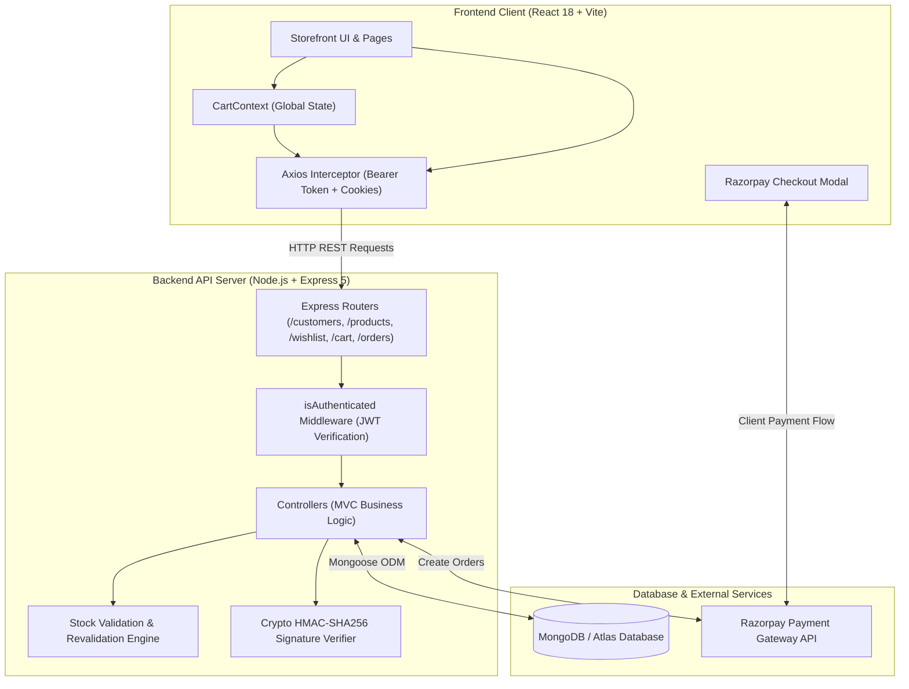
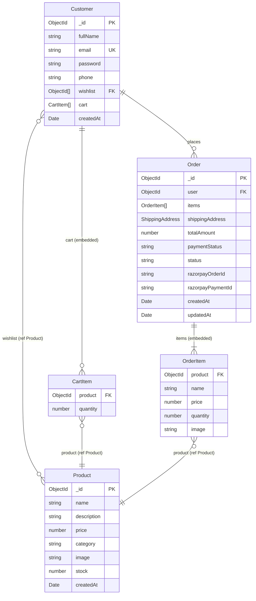
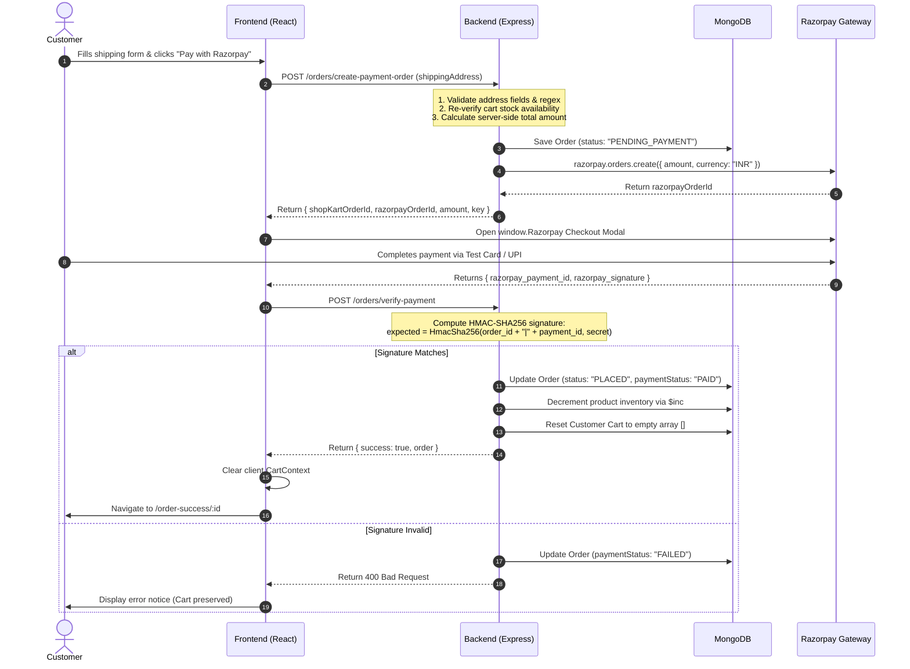

# 🛒 ShopKart — Modern Full-Stack E-Commerce Web Application

[](https://nodejs.org/)
[](https://expressjs.com/)
[](https://react.dev/)
[](https://vitejs.dev/)
[](https://www.mongodb.com/)
[](https://razorpay.com/)
[](https://jwt.io/)
[](https://vercel.com/)
[](https://opensource.org/licenses/ISC)

> **ShopKart** is a production-grade, full-stack e-commerce web application engineered with the **MERN** (MongoDB, Express.js, React, Node.js) architecture. It delivers a fast, responsive, and secure shopping experience featuring customer authentication, product catalog discovery with live debounced search and category filtering, wishlist management, persistent shopping bag with real-time stock ceiling validation, secure **Razorpay payment gateway** integration with server-side HMAC-SHA256 signature verification, and live order tracking with interactive status progression.

---

## 📑 Table of Contents

- [Overview & Architecture](#-overview--architecture)
- [Key Features](#-key-features)
- [Bonus Challenge (+10 Marks)](#-bonus-challenge-10-marks)
- [Tech Stack](#-tech-stack)
- [Database Schema & Models](#-database-schema--models)
- [API Endpoints Reference](#-api-endpoints-reference)
- [Project Directory Structure](#-project-directory-structure)
- [Environment Variables Configuration](#-environment-variables-configuration)
- [Step-by-Step Installation & Local Setup](#-step-by-step-installation--local-setup)
- [Database Seeding](#-database-seeding)
- [Razorpay Payment Lifecycle & Security](#-razorpay-payment-lifecycle--security)
- [Evaluation & Testing Guide](#-evaluation--testing-guide)
- [Deployment Guide](#-deployment-guide)
- [Future Roadmap](#-future-roadmap)
- [Author & License](#-author--license)

---

## 🏗️ Overview & Architecture

ShopKart is built following clean **MVC (Model-View-Controller)** design principles on the backend and a **component-driven, reactive architecture** on the frontend. The system separates concerns between data storage, business logic, authentication security, and presentation.

### Architectural Diagram



### Architectural Principles

1. **Server-Side Single Source of Truth**: Product pricing and inventory calculations are strictly executed on the server to prevent client-side price tampering.
2. **Dual-Layer Authentication Resilience**: Supports both `HttpOnly` cookies and `Bearer` authorization headers, ensuring seamless sessions even in privacy-hardened browsers (such as Brave Shields) or cross-origin deployment topologies.
3. **Optimistic & Synchronized State**: Global shopping bag and wishlist state are managed via React Context with immediate visual feedback and persistent database synchronization.
4. **Resilient Payment Verification**: Cryptographic payment signatures are validated using `crypto.createHmac('sha256', secret)` before orders transition from `PENDING_PAYMENT` to `PLACED`.

---

## ✨ Key Features

### 🔐 1. Customer Authentication & Account Security
- **Secure Registration & Login**: Password hashing with `bcrypt` (10 salt rounds) and session encryption using `jsonwebtoken` (JWT, 7-day validity).
- **Dual Token Transmission**: Returns JWT as an `HttpOnly`, `SameSite` cookie and as a bearer token in JSON responses stored in `localStorage`, sent via Axios request interceptors.
- **Registration Success Modal**: Interactive modal with an animated countdown timer (3 seconds) that automatically transitions newly registered users to the login screen with prefilled email.
- **Session Verification**: Dedicated `/customers/me` endpoint verified by frontend `ProtectedRoute` wrappers to prevent unauthorized access.
- **Account Password Management**: Collapsible password modification form on the home dashboard verifying existing credentials before applying updates.
- **Clean Logout**: Removes client tokens, clears server cookies, and resets in-memory cart and wishlist badge counts.

### 🛍️ 2. Product Catalog Discovery & Filtering
- **Category Browsing**: Dedicated category circle showcase and filter tabs for **Electronics**, **Audio**, **Fashion**, **Home & Living**, and **Books & Media**.
- **Live Debounced Search**: Real-time product search with debouncing (250ms) to ensure responsive queries without overloading the API.
- **Multi-Parameter Sorting**: Sort catalog items by **Price: Low to High**, **Price: High to Low**, or **Newest arrivals**.
- **Real-Time Stock Badges**: Real-time stock status display showing units remaining, "In Stock", or "Out of Stock" disabled states.
- **Image Error Fallback Handling**: Automatic image fallback to high-quality placeholders if third-party image URLs fail to load.

### ❤️ 3. Dynamic Wishlist System
- **One-Click Toggle**: Wishlist buttons with instant UI state changes across Product Cards and Product Details pages.
- **Navbar Live Counter**: Dynamic badge displaying real-time count of saved items via `/wishlist/count`.
- **Wishlist Hub**: Dedicated page to review saved items, inspect availability, move items directly to the shopping cart, or remove them with feedback toasts.

### 🛒 4. Smart Shopping Bag & Inventory Engine
- **Persistent Cart State**: Cart items are persisted to the customer's MongoDB document, ensuring items remain across sessions and devices.
- **Stock Ceiling Enforcement**: Quantities cannot exceed available inventory; interactive increment buttons are capped at the product's actual stock limit.
- **Free Shipping Progress Tracker**: Dynamic notification banner calculating the remaining balance needed to unlock Free Nationwide Express Shipping (orders $\ge$ ₹499).
- **Cart Management**: Real-time quantity adjustments, item deletions, and complete bag clearing with confirmation modals.

### 💳 5. Razorpay Payment Gateway & Checkout
- **Express Multi-Step Checkout**:
  - **Step 1**: Validated shipping form (Full Name, 10–15 digit phone validation, Street Address, City, State, and strict 6-digit Indian Pincode validation).
  - **Step 2**: Order review sidebar summarizing items, quantities, subtotal, and free delivery qualification.
  - **Step 3**: Razorpay Checkout modal launch with branded parameters and pre-filled customer details.
- **Stock Revalidation**: Re-verifies all product stock balances immediately before initiating order creation.
- **HMAC-SHA256 Signature Verification**: Server validates the authenticity of `razorpay_order_id`, `razorpay_payment_id`, and `razorpay_signature`.
- **Automatic Stock Decrement**: Safely decrements purchased product stock quantities upon payment verification using `$inc`.
- **Cart Auto-Clear**: Automatically resets the customer's cart upon order confirmation.
- **Offline / Sandbox Testing Modal**: Integrated offline modal simulator that allows testing the payment verification cycle even if third-party Razorpay CDNs are unreachable.

### 📦 6. Order History & Live Delivery Tracking
- **Order Snapshots**: Orders snapshot product names, prices, images, and quantities at the time of purchase, preserving data integrity regardless of future product updates.
- **Order Confirmation Page**: Detailed post-checkout receipt screen with order reference, delivery address, items snapshot, and quick navigation.
- **Comprehensive Orders List**: Chronological order history with status pills (`PLACED`, `CONFIRMED`, `SHIPPED`, `DELIVERED`) and payment indicators (`PAID`, `PENDING`, `FAILED`).
- **Interactive Tracking Timeline**: Visual step-by-step progress track showing live order milestones.
- **Technical Reference Drawer**: Secure collapsible drawer displaying masked Razorpay gateway references with copy-to-clipboard functionality.

---

## 🌟 Bonus Challenge (+10 Marks)

As implemented in `backend/routes/order.routes.js`, `backend/controllers/order.controller.js`, and `frontend/src/pages/OrderDetails.jsx`:

> **Interactive Order Status Progression Controller**:
> The project includes a dedicated administrative/development status update endpoint (`PATCH /orders/:id/status`) and an interactive **Live Delivery Status Timeline** in the UI. 
> 
> Evaluators and instructors can advance any placed order through the four full fulfillment stages:
> $$\text{PLACED} \longrightarrow \text{CONFIRMED} \longrightarrow \text{SHIPPED} \longrightarrow \text{DELIVERED}$$
> 
> Clicking any status progression button updates the database record in real-time, animates the delivery timeline nodes, and displays confirmation notifications.

---

## 💻 Tech Stack

| Layer | Technology | Version | Purpose |
| :--- | :--- | :--- | :--- |
| **Frontend Framework** | [React](https://react.dev/) | `^18.2.0` | Declarative, component-based user interface |
| **Build Tool** | [Vite](https://vitejs.dev/) | `^5.0.0` | Ultra-fast HMR and frontend bundling |
| **Routing** | [React Router DOM](https://reactrouter.com/) | `^6.14.1` | Client-side declarative routing and protected routes |
| **HTTP Client** | [Axios](https://axios-http.com/) | `^1.4.0` | API requests with credentials and bearer token interceptors |
| **Design System** | Custom CSS / Preline UI | — | Responsive modern design system with CSS custom properties |
| **Backend Runtime** | [Node.js](https://nodejs.org/) | `>=18.x` | Server-side JavaScript runtime (ES Modules) |
| **Web Framework** | [Express.js](https://expressjs.com/) | `^5.2.1` | RESTful API server and route handlers |
| **Database** | [MongoDB](https://www.mongodb.com/) | `>=6.0` | NoSQL document database |
| **ODM** | [Mongoose](https://mongoosejs.com/) | `^9.9.4` | Schema definitions, validations, and population queries |
| **Authentication** | [jsonwebtoken](https://jwt.io/) | `^9.0.3` | Cryptographic JWT signing and session verification |
| **Password Hashing**| [bcrypt](https://github.com/kelektiv/node.bcrypt.js) | `^6.0.0` | Salted password hashing |
| **Payment Gateway** | [Razorpay](https://razorpay.com/) | `^2.9.8` | Order creation and payment processing SDK |
| **Cookie Parsing** | [cookie-parser](https://github.com/expressjs/cookie-parser) | `^1.4.7` | Secure cookie serialization and extraction |
| **Environment** | [dotenv](https://github.com/motdotla/dotenv) | `^17.4.2` | Environment configuration management |
| **Deployment** | [Vercel](https://vercel.com/) | — | Production SPA rewrites (`vercel.json`) |

---

## 🗄️ Database Schema & Models



### Detailed Schema Definitions

#### 1. Customer (`backend/models/customer.model.js`)
- `fullName` *(String, required, trim)*
- `email` *(String, required, unique, lowercase, trim)*
- `password` *(String, required, min 6 characters)*
- `phone` *(String, required, trim)*
- `wishlist` *([ObjectId], ref: "Product")*
- `cart` *([ { product: ObjectId (ref: "Product"), quantity: Number (min 1, default 1) } ])*
- `createdAt` *(Date, default: Date.now)*

#### 2. Product (`backend/models/product.model.js`)
- `name` *(String, required, trim)*
- `description` *(String, required, trim)*
- `price` *(Number, required, min: 0.01)*
- `category` *(String, required, trim)*
- `image` *(String, required, trim)*
- `stock` *(Number, required, min: 0)*
- `createdAt` *(Date, default: Date.now)*

#### 3. Order (`backend/models/order.model.js`)
- `user` *(ObjectId, ref: "Customer", required)*
- `items` *([ { product: ObjectId, name: String, price: Number, quantity: Number, image: String } ])*
- `shippingAddress` *({ fullName: String, phone: String, addressLine1: String, city: String, state: String, pincode: String })*
- `totalAmount` *(Number, required, min: 0)*
- `paymentStatus` *(String, enum: `["PENDING", "PAID", "FAILED"]`, default: `"PENDING"`)*
- `status` *(String, enum: `["PENDING_PAYMENT", "PLACED", "CONFIRMED", "SHIPPED", "DELIVERED"]`, default: `"PENDING_PAYMENT"`)*
- `razorpayOrderId` *(String, default: "")*
- `razorpayPaymentId` *(String, default: "")*
- `timestamps` *(createdAt, updatedAt)*

---

## 📡 API Endpoints Reference

All endpoints accept and return `application/json`. Protected endpoints require valid authentication through either an `HttpOnly` JWT cookie or an `Authorization: Bearer <token>` header.

### 1. Customer & Authentication Routes (`/customers`)

| Method | Endpoint | Access | Description | Request Body |
| :--- | :--- | :--- | :--- | :--- |
| `POST` | `/customers/register` | Public | Register a new customer | `{ fullName, email, password, phone }` |
| `POST` | `/customers/login` | Public | Authenticate customer & issue token | `{ email, password }` |
| `GET` | `/customers/me` | Protected | Fetch current customer profile | *None* |
| `POST` | `/customers/logout` | Protected | Clear session cookie & logout | *None* |
| `PATCH`| `/customers/change-password` | Protected | Update customer account password | `{ oldPassword, newPassword }` |

### 2. Product Catalog Routes (`/products`)

| Method | Endpoint | Access | Description | Query / Body Params |
| :--- | :--- | :--- | :--- | :--- |
| `GET` | `/products` | Public | Fetch all products with filter/search | Query: `?search=...&category=...&sort=price_asc\|price_desc` |
| `GET` | `/products/categories` | Public | Fetch list of distinct categories | *None* |
| `GET` | `/products/:id` | Public | Fetch single product by MongoDB ID | Param: `:id` |
| `POST`| `/products` | Public | Create new catalog item | `{ name, description, price, category, image, stock }` |

### 3. Wishlist Routes (`/wishlist`)

| Method | Endpoint | Access | Description | Parameters |
| :--- | :--- | :--- | :--- | :--- |
| `GET` | `/wishlist` | Protected | Retrieve all populated wishlist items | *None* |
| `GET` | `/wishlist/count` | Protected | Get total count of saved items | *None* |
| `POST` | `/wishlist/:productId` | Protected | Add a product to wishlist | Param: `:productId` |
| `DELETE`| `/wishlist/:productId` | Protected | Remove a product from wishlist | Param: `:productId` |
| `PATCH` | `/wishlist/:productId/toggle`| Protected | Toggle product in/out of wishlist | Param: `:productId` |

### 4. Shopping Cart Routes (`/cart`)

| Method | Endpoint | Access | Description | Request Body |
| :--- | :--- | :--- | :--- | :--- |
| `GET` | `/cart` | Protected | Fetch customer's populated cart | *None* |
| `POST` | `/cart/:productId` | Protected | Add 1 unit of product to cart | Param: `:productId` |
| `PATCH`| `/cart/:productId` | Protected | Update quantity (capped by stock) | `{ quantity: Number }` |
| `DELETE`| `/cart/:productId` | Protected | Remove item from cart | Param: `:productId` |
| `DELETE`| `/cart` | Protected | Clear entire cart | *None* |

### 5. Order & Payment Routes (`/orders`)

| Method | Endpoint | Access | Description | Request Body |
| :--- | :--- | :--- | :--- | :--- |
| `POST` | `/orders/create-payment-order` | Protected | Validate cart, recheck stock, create Razorpay order | `{ shippingAddress: { fullName, phone, addressLine1, city, state, pincode } }` |
| `POST` | `/orders/verify-payment` | Protected | Verify HMAC signature, decrement stock, mark order `PAID` | `{ shopKartOrderId, razorpay_order_id, razorpay_payment_id, razorpay_signature }` |
| `GET` | `/orders` | Protected | Fetch all orders for authenticated user | *None* |
| `GET` | `/orders/:id` | Protected | Get detailed order invoice & tracking | Param: `:id` |
| `PATCH`| `/orders/:id/status` | Protected | **Bonus Challenge**: Update delivery status | `{ status: "PLACED" \| "CONFIRMED" \| "SHIPPED" \| "DELIVERED" }` |

---

## 📂 Project Directory Structure

```text
SHOPKART-PROJECT/
├── .gitignore                      # Git ignored files & environments
├── README.md                       # Comprehensive project documentation
│
├── backend/                        # Node.js + Express.js API Server
│   ├── config/
│   │   └── razorpay.js             # Razorpay SDK initialization & keys
│   ├── controllers/
│   │   ├── cart.controller.js      # Cart CRUD & inventory limits
│   │   ├── customer.controller.js  # Auth (register, login, password change)
│   │   ├── order.controller.js     # Payment initiation, HMAC verification, status update
│   │   ├── product.controller.js   # Catalog queries, search, filter, and sorting
│   │   └── wishlist.controller.js  # Wishlist toggle, population, and count
│   ├── middlewares/
│   │   └── auth.middleware.js      # JWT authentication verification middleware
│   ├── models/
│   │   ├── customer.model.js       # Customer schema with embedded cart & wishlist refs
│   │   ├── order.model.js          # Order schema with snapshots & delivery status
│   │   └── product.model.js        # Product schema with validations
│   ├── routes/
│   │   ├── cart.routes.js          # Mounted at /cart
│   │   ├── customer.routes.js      # Mounted at /customers
│   │   ├── order.routes.js         # Mounted at /orders
│   │   ├── product.routes.js       # Mounted at /products
│   │   └── wishlist.routes.js      # Mounted at /wishlist
│   ├── utils/
│   │   └── generateToken.js        # JWT token generation utility (7-day validity)
│   ├── .env.example                # Template for backend environment variables
│   ├── index.js                    # Express application entry point & CORS configuration
│   ├── package.json                # Backend dependencies & npm scripts
│   └── seedProducts.js             # Seed script populating 16 catalog items across 5 categories
│
└── frontend/                       # React 18 + Vite Storefront Application
    ├── public/                     # Static assets
    ├── src/
    │   ├── components/
    │   │   ├── CartItem.jsx        # Cart line item with quantity stepper & removal
    │   │   ├── Footer.jsx          # Modern footer with branding, links & guarantees
    │   │   ├── Icons.jsx           # Crisp SVG icon components
    │   │   ├── Navbar.jsx          # Header with search, badge counters, and account menu
    │   │   ├── ProductCard.jsx     # Catalog card with wishlist toggle & stock badges
    │   │   ├── ProtectedRoute.jsx  # Client-side session guard with modern loader
    │   │   ├── SearchBar.jsx       # Debounced search input component
    │   │   └── WishlistCard.jsx    # Wishlist card with 'Move to Bag' capability
    │   ├── context/
    │   │   └── CartContext.jsx     # Global shopping cart provider & derived metrics
    │   ├── pages/
    │   │   ├── Cart.jsx            # Shopping bag overview & free shipping indicator
    │   │   ├── Checkout.jsx        # Shipping form, Razorpay checkout modal & offline simulator
    │   │   ├── Home.jsx            # Hero banner, category circles, bento grid & account hub
    │   │   ├── Login.jsx           # Split-screen login view with validation
    │   │   ├── OrderDetails.jsx    # Order invoice, live timeline & status progression buttons
    │   │   ├── Orders.jsx          # Customer order history dashboard
    │   │   ├── OrderSuccess.jsx    # Post-payment confirmation receipt
    │   │   ├── ProductDetails.jsx  # Rich product specifications, stock status & Add to Cart
    │   │   ├── Products.jsx        # Searchable, filterable catalog grid with breadcrumbs
    │   │   ├── Register.jsx        # Registration view with auto-redirect countdown modal
    │   │   └── Wishlist.jsx        # Saved products gallery & empty state
    │   ├── services/
    │   │   └── api.js              # Axios instance configured with base URL & interceptors
    │   ├── App.jsx                 # Application routes configuration
    │   ├── index.css               # Complete storefront design system & stylesheets
    │   └── main.jsx                # React DOM root entry point
    ├── .env.example                # Template for frontend environment variables
    ├── index.html                  # HTML entry with font preloads & Razorpay script support
    ├── package.json                # Frontend dependencies & scripts
    └── vercel.json                 # Single Page Application (SPA) rewrite rules for Vercel
```

---

## ⚙️ Environment Variables Configuration

### Backend Environment Configuration (`backend/.env`)

Create a `.env` file in the `backend/` directory by copying `.env.example`:

```bash
cp backend/.env.example backend/.env
```

| Variable | Required | Default / Example Value | Description |
| :--- | :---: | :--- | :--- |
| `PORT` | Optional | `8081` | Port on which the Express server listens |
| `NODE_ENV` | Optional | `development` | Environment mode (`development` or `production`) |
| `MONGO_URI` | **Required** | `mongodb://127.0.0.1:27017/shopkart` | MongoDB connection URI (Local or Atlas) |
| `JWT_SECRET` | **Required** | `shopkart_jwt_secret_key_2026` | Secret key used to sign and verify JWT tokens |
| `RAZORPAY_KEY_ID` | **Required** | `rzp_test_ShopKartKeyId` | Razorpay Test API Key ID from Dashboard |
| `RAZORPAY_KEY_SECRET` | **Required**| `shopkart_test_secret_key_2026` | Razorpay Test API Key Secret for HMAC verification |

### Frontend Environment Configuration (`frontend/.env`)

Create a `.env` file in the `frontend/` directory by copying `.env.example`:

```bash
cp frontend/.env.example frontend/.env
```

| Variable | Required | Default / Example Value | Description |
| :--- | :---: | :--- | :--- |
| `VITE_API_BASE_URL` | **Required** | `http://localhost:8081` | Root URL pointing to the running backend API |

---

## 🚀 Step-by-Step Installation & Local Setup

### Prerequisites
- **Node.js**: `v18.0.0` or higher ([Download Node.js](https://nodejs.org/))
- **npm**: `v9.0.0` or higher
- **MongoDB**: Local MongoDB instance running on port `27017` OR a free [MongoDB Atlas](https://www.mongodb.com/cloud/atlas) cluster
- **Git**: Installed on your system

---

### 1. Clone the Repository

```bash
git clone https://github.com/mahakagarwal7/SHOPKART-PROJECT.git
cd SHOPKART-PROJECT
```

---

### 2. Backend Setup & Startup

1. **Navigate to the backend directory**:
   ```bash
   cd backend
   ```

2. **Install backend dependencies**:
   ```bash
   npm install
   ```

3. **Configure Environment Variables**:
   ```bash
   cp .env.example .env
   ```
   *(Ensure `MONGO_URI` matches your MongoDB connection string. Default works with local MongoDB).*

4. **Seed the Product Catalog**:
   Populate MongoDB with 16 curated products across Electronics, Audio, Fashion, Home, and Books:
   ```bash
   npm run seed
   ```
   *Expected output:*
   ```text
   Connected to MongoDB for seeding...
   Cleared existing products.
   Successfully seeded 16 products across all categories!
   ```

5. **Start the Backend Server**:
   ```bash
   # Development mode with hot-reloading (nodemon)
   npm run dev

   # Or standard production mode
   npm run start
   ```
   *Expected output:*
   ```text
   Server started at http://localhost:8081
   DB Connected Successfully
   ```

---

### 3. Frontend Setup & Startup

Open a **new terminal tab or window**:

1. **Navigate to the frontend directory**:
   ```bash
   cd frontend
   ```

2. **Install frontend dependencies**:
   ```bash
   npm install
   ```

3. **Configure Frontend Environment**:
   ```bash
   cp .env.example .env
   ```
   *(Ensures `VITE_API_BASE_URL=http://localhost:8081`).*

4. **Launch the Frontend Development Server**:
   ```bash
   npm run dev
   ```
   *Expected output:*
   ```text
     VITE v5.x.x  ready in 300 ms

     ➜  Local:   http://localhost:5173/
     ➜  Network: use --host to expose
   ```

5. **Access the Application**:
   Open your browser and navigate to **`http://localhost:5173`**.

---

## 🌱 Database Seeding

The backend includes a pre-configured seeding script (`backend/seedProducts.js`) that primes the database with realistic inventory data:

```bash
npm run seed --prefix backend
```

### Seeded Categories & Sample Inventory:
- **Electronics**: Ultra-Slim 4K Monitor 27" (₹18,999), Mechanical Gaming Keyboard (₹2,999), Precision Wireless Mouse (₹1,499), Smart AMOLED Fitness Watch (₹3,499).
- **Audio**: Studio Wireless Headphones (₹4,999), Portable Waterproof Bluetooth Speaker (₹2,499), True Wireless Noise-Cancelling Earbuds (₹3,999).
- **Fashion**: Classic Vintage Denim Jacket (₹2,499), Lightweight Breathable Running Shoes (₹3,299), Minimalist Polarized Sunglasses (₹1,799), Canvas Commuter Laptop Backpack (₹2,199).
- **Home & Living**: Architect Dimmable LED Desk Lamp (₹1,899), Ceramic Pour-Over Coffee Brewer Set (₹1,599), Ultrasonic Essential Oil Aroma Diffuser (₹1,299).
- **Books & Media**: The Pragmatic Programmer (20th Anniversary Edition) (₹1,299), Atomic Habits by James Clear (₹699).

---

## 🔒 Razorpay Payment Lifecycle & Security

ShopKart implements a rigorous, server-verified financial transaction pipeline compliant with e-commerce security standards:



### Security Measures Implemented
- **No Client Price Tampering**: Cart item prices passed by the client are discarded; unit prices are directly fetched from MongoDB during order creation.
- **Stock Re-verification**: Even if an item was added to the cart earlier, its stock is re-verified at the instant of order creation to prevent negative inventory.
- **HMAC Cryptographic Proof**: Payment authorization is impossible without possessing the private `RAZORPAY_KEY_SECRET`.
- **Atomic Inventory Updates**: Product stock decrements use MongoDB's atomic `$inc: { stock: -item.quantity }`.

---

## 🧪 Evaluation & Testing Guide

Instructors and reviewers can follow this step-by-step test path to verify all system functionality:

### 1. Test Customer Registration & Login
1. Open `http://localhost:5173/`. You are automatically redirected to `/login`.
2. Click **Create an account** or navigate to `/register`.
3. Fill in:
   - Full Name: `Test Evaluator`
   - Email: `evaluator@shopkart.com`
   - Phone: `9876543210`
   - Password: `password123`
4. Click **Create Free Account**. Observe the **Registration Success Modal** with a live 3-second countdown automatically redirecting you to `/login` with the email prefilled.
5. Enter `password123` and sign in. You are redirected to `/home`.

### 2. Test Storefront Catalog Discovery & Search
1. On `/home`, explore the **Curated Collection** hero banner, **Category Circles**, and **Trending Now** section.
2. Click **All Products** or use the top navigation link to open `/products`.
3. Type `"Monitor"` in the search bar. Observe the live debounced search updating the catalog.
4. Filter by category (e.g., select **Audio**).
5. Sort by **Price: High to Low** and verify the order of cards.

### 3. Test Wishlist Management
1. Click the **Heart icon** on any product card.
2. Notice the heart turns filled red with immediate optimistic feedback.
3. Observe the **Navbar Wishlist Counter** badge update to `1`.
4. Navigate to `/wishlist`. Verify the product appears in the list.
5. Click **Add to Bag** from the Wishlist card. Notice the cart count updates.

### 4. Test Cart & Stock Constraints
1. Navigate to `/products` and open a product details page (e.g., *Ultra-Slim 4K Monitor*).
2. Click **Add to Shopping Bag**.
3. Navigate to `/cart`.
4. Test the quantity stepper (`+` and `-`). Try incrementing beyond the product's available stock—notice the app prevents exceeding stock limits.
5. Observe the **Free Shipping Progress Bar** adjusting as the subtotal changes.

### 5. Test Checkout & Payment Verification
1. On `/cart`, click **Proceed to Checkout** to open `/checkout`.
2. Fill out the shipping form:
   - Full Name: `Test Evaluator`
   - Phone: `9876543210`
   - Street: `Flat 401, Tech Park Avenue`
   - City: `Bengaluru`
   - State: `Karnataka`
   - Pincode: `560001`
3. Click **Pay with Razorpay**.
4. The Razorpay Test Checkout modal opens. Use test payment credentials (or in sandbox mode, use the simulation options).
5. Upon successful payment verification, you are immediately routed to `/order-success/:id` displaying the receipt.
6. Verify that the shopping cart icon badge now shows `0`.

### 6. Test Bonus Challenge: Live Delivery Progression (+10 Marks)
1. Navigate to **My Orders** (`/orders`) via the account menu or navbar.
2. Locate the recently placed order and click **View & Track Order** to open `/orders/:id`.
3. Scroll to the **Live Delivery Status Timeline**. Notice the order is currently at step `PLACED`.
4. Under **Demo Status Progression**, click **Set CONFIRMED**. Observe the timeline update in real time.
5. Click **Set SHIPPED**, then **Set DELIVERED**. Observe the progress bar advance to 100% completion with green checkmarks.
6. Inspect the **Payment & Transaction** card, and expand the **Gateway Reference Details** drawer to verify masked order references and copyable receipt IDs.

---

## 🌐 Deployment Guide

### Frontend Deployment on Vercel

The frontend includes a configured `frontend/vercel.json` to handle Single Page Application (SPA) routing:

```json
{
  "rewrites": [
    {
      "source": "/(.*)",
      "destination": "/index.html"
    }
  ]
}
```

1. Push your code to GitHub.
2. Import the repository into [Vercel](https://vercel.com/).
3. Set the **Root Directory** to `frontend`.
4. Add the Environment Variable:
   - `VITE_API_BASE_URL`: `https://your-backend-domain.com`
5. Deploy.

### Backend Deployment (Render / Railway / VPS)

1. Deploy the `backend/` folder to your Node.js cloud hosting provider.
2. Configure environment variables in the host dashboard:
   - `PORT`: `8081` (or provider's default)
   - `NODE_ENV`: `production`
   - `MONGO_URI`: Your MongoDB Atlas cluster connection string
   - `JWT_SECRET`: A secure random cryptographic key
   - `RAZORPAY_KEY_ID`: Your Razorpay Key ID
   - `RAZORPAY_KEY_SECRET`: Your Razorpay Key Secret
3. Run `npm run seed` once in the production shell if you wish to populate initial catalog data.

---

## 🔮 Future Roadmap

- [ ] **Admin Dashboard**: Dedicated admin panel for product inventory uploads and stock updates.
- [ ] **Product Reviews & Ratings**: Allow verified purchasers to leave star ratings and comments.
- [ ] **Coupon & Discount Engine**: Promo code validation at checkout.
- [ ] **Email & SMS Notifications**: Transactional receipts dispatched via SendGrid / Twilio.
- [ ] **Dark Mode Support**: Seamless theme switching between light and dark modes.

---

## 👤 Author & Acknowledgements

- **Author**: Mahak Agarwal ([@mahakagarwal7](https://github.com/mahakagarwal7))
- **Project Repository**: [SHOPKART-PROJECT on GitHub](https://github.com/mahakagarwal7/SHOPKART-PROJECT)
- **License**: This project is licensed under the **ISC License**.

